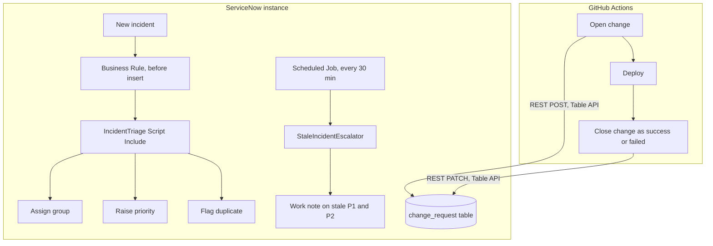

# ServiceNow DevOps Automation

Two things ServiceNow teams do by hand, automated and tested:

1. **Incident auto-triage:** new incidents are routed to the right group, prioritised from impact, urgency and wording, and checked for duplicates. Stale P1/P2 incidents are flagged automatically.
2. **Pipeline-to-change-management:** a CI/CD pipeline opens a ServiceNow change request before deploying and closes it as successful or failed afterwards, giving an audit trail without manual ticket work.


Companion to [devops-platform](https://github.com/mohd-21/devops-platform), whose pipeline can call this integration.

## How it fits together



## Repository layout

| Path | Purpose |
|---|---|
| `src/script_includes/` | `IncidentTriage`, `StaleIncidentEscalator`: all the logic |
| `src/business_rules/` | Thin Business Rule that calls `IncidentTriage` on insert |
| `src/client_scripts/` | Form guidance for high-impact incidents |
| `src/scheduled_jobs/` | Job that runs the escalator |
| `pipeline/servicenow_change.py` | Stdlib-only CLI to open and close change requests (retries on 5xx, no retries on 4xx) |
| `.github/workflows/change-managed-deploy.yml` | Reusable workflow: open change, deploy, close change |
| `tests/` | 13 Node tests (platform APIs mocked) and 11 Python tests (HTTP mocked) |
| `docs/setup.md` | Step-by-step install on a ServiceNow instance |

## Design decisions

- **Logic lives in Script Includes, Business Rules stay thin.** That keeps rules readable and lets the logic be unit tested outside the platform with small mocks of `GlideRecord` and `GlideDateTime`.
- **Automation never overrides people.** A group chosen manually is kept, and triage only ever raises priority, never lowers it.
- **Whole-word keyword matching,** so "down" does not fire on "download".
- **Batch limit and update-resets-timer** in the escalator avoid flooding notifications and long-running jobs.
- **Credentials only through environment variables or Actions secrets,** never command-line arguments, so they do not appear in logs.
- **Change closes even when the deploy fails** (`if: always()`), recording an unsuccessful change instead of leaving it open.

## Run the tests

```bash
npm test          # ServiceNow script logic (Node 20+)
npm run test:py   # change-request integration (Python 3.9+)
```

## Use the pipeline integration

Locally:

```bash
export SN_INSTANCE=dev12345 SN_USER=svc_github_pipeline SN_PASSWORD=...
python3 pipeline/servicenow_change.py create --summary "Deploy checkout 1.4.0"
python3 pipeline/servicenow_change.py close --sys-id <sys_id> --result success
```

From another repository's workflow:

```yaml
jobs:
  release:
    uses: mohd-21/servicenow-devops-automation/.github/workflows/change-managed-deploy.yml@main
    with:
      summary: "Deploy checkout ${{ github.sha }}"
    secrets: inherit
```

## Installing in ServiceNow

See [docs/setup.md](docs/setup.md). Try it on a free personal developer instance first.

## Limitations

- The ServiceNow scripts are tested against mocks of the platform APIs, not a live instance. Always verify on a dev instance.
- Change request fields and states vary between instances, so adjust the payload builders in `pipeline/servicenow_change.py` to your change model.
- Keyword rules are intentionally simple and editable in `GROUP_RULES` and `CRITICAL_TERMS`.
